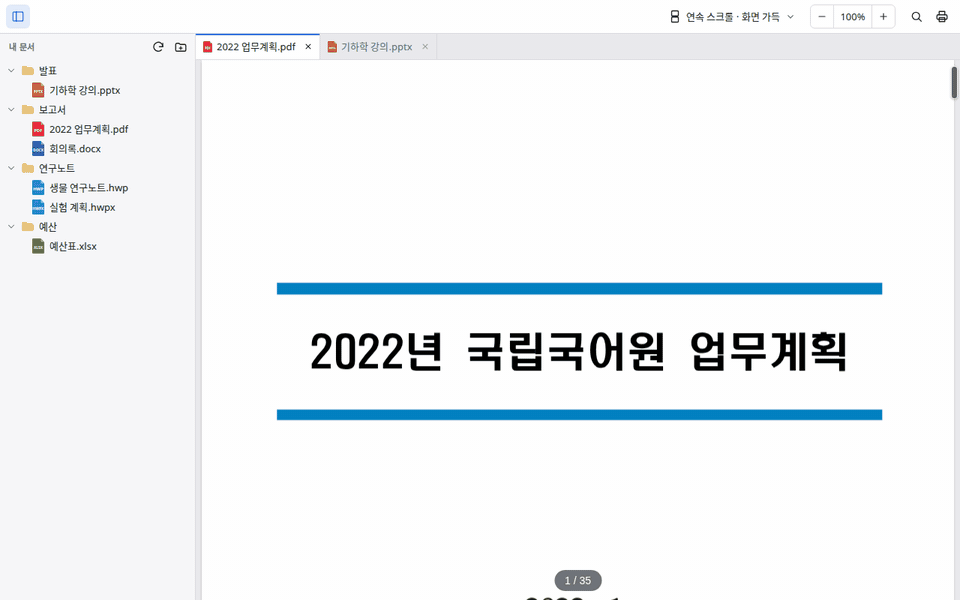
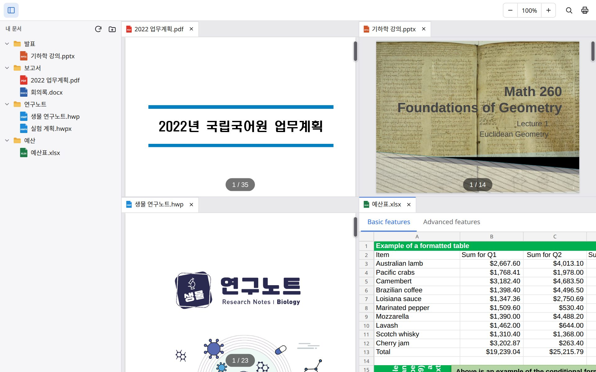
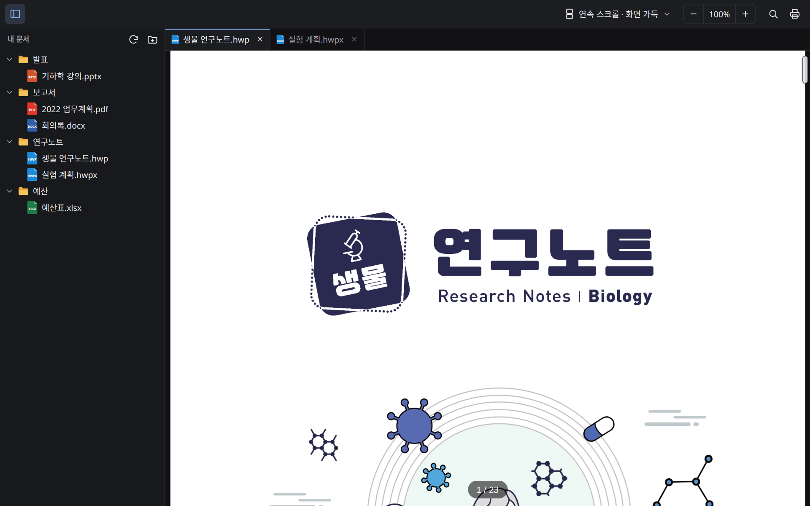
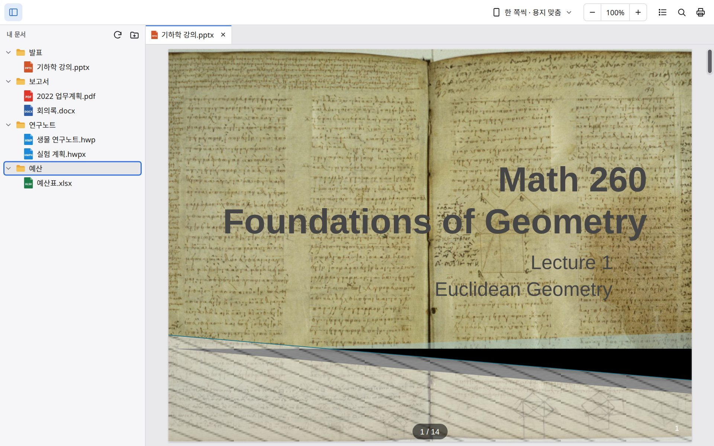

<div align="center">

# Doc Viewer

PDF, 한글, 워드, 엑셀, 파워포인트 문서를 보는 데스크톱 뷰어입니다. 인터넷 없이 Windows, macOS, Linux에서 씁니다.

[](https://github.com/jwgung/doc-viewer/releases/latest)
[](#내려받기)
[](https://github.com/jwgung/doc-viewer/actions/workflows/ci.yml)

[English](README.md) · **한국어**


</div>

오피스나 한글이 설치돼 있지 않아도 문서를 열 수 있습니다. 문서는 앱 안에서 그리고, 어디에도 올리지 않습니다. 계정이 없고 사용 기록도 모으지 않습니다.

사이트: https://jwgung.github.io/doc-viewer/ko/

## 기능

- **문서 형식:** PDF, 한글(HWP/HWPX), DOC/DOCX, XLS/XLSX/CSV, PPT/PPTX, 마크다운, 텍스트, 그림. 확장자가 틀려도 내용으로 형식을 알아봅니다.
- **폴더와 탭:** 사이드바에서 폴더를 열고 여러 문서를 탭으로 띄웁니다. 이름 바꾸기와 삭제도 사이드바에서 합니다.
- **화면 나누기:** 탭이나 파일을 문서 가장자리로 끌어 놓으면 화면이 나뉩니다(최대 4칸).
- **이어 보기:** 다시 켜면 열려 있던 탭, 보던 쪽, 확대, 나눈 화면이 그대로 열립니다. 닫은 탭은 <kbd>Ctrl</kbd>+<kbd>Shift</kbd>+<kbd>T</kbd>로 다시 엽니다. 탭을 복제해 한 문서의 두 곳을 나란히 볼 수 있습니다.
- **슬라이드 동영상:** PPTX에 들어 있는 동영상과 소리를 슬라이드에서 재생합니다.
- **밝은 화면과 어두운 화면:** 시스템 설정을 따릅니다.

<div align="center">

<br><sub>탭이나 파일을 가장자리로 끌어 놓으면 화면이 나뉩니다.</sub>
</div>

## 내려받기

**[Releases](https://github.com/jwgung/doc-viewer/releases/latest)** 에서 최신 버전을 받으세요.

| 운영체제 | 파일 | 처음 열 때 |
|---|---|---|
| **Windows** 10 / 11 | `…-windows-setup.exe` (또는 `…-windows.msi`) | 아직 코드 서명이 없어 SmartScreen이 뜨면 **추가 정보 → 실행** |
| **macOS** (Apple 실리콘·Intel 공용) | `…-macos.dmg` | 아직 공증 전이라 경고가 뜨면 앱을 우클릭 → **열기**, 또는 *시스템 설정 → 개인정보 보호 및 보안*에서 허용 |
| **Linux** (Ubuntu 22.04 이상 등) | `…-linux-amd64.deb` 또는 `…-linux-amd64.AppImage` | AppImage는 실행 권한을 주고(`chmod +x`) 실행 |

> [!NOTE]
> WebView2가 없는 구형 Windows 10은 설치할 때 한 번 내려받습니다. 인터넷이 필요한 건 그때뿐입니다.
> macOS·Linux 판은 새로 나왔습니다. 이상한 점이 있으면 [이슈](https://github.com/jwgung/doc-viewer/issues)로 알려 주세요.

## 여는 형식

| 종류 | 확장자 |
|---|---|
| PDF | `pdf` |
| 한글 | `hwp`, `hwpx`, `hwt` |
| Word | `doc`, `docx`, `docm`, `dot`, `dotx`, `dotm` |
| Excel | `xls`, `xlsx`, `xlsm`, `xlt`, `xltx`, `xltm`, `csv`, `tsv` |
| PowerPoint | `ppt`, `pptx`, `pptm`, `pps`, `ppsx`, `pot`, `potx` |
| 텍스트·데이터 | `md`, `txt`, `log`, `json`, `xml`, `toml`, `yaml`, 그 밖의 글자 파일(설정·소스 코드·자막·diff) |
| 그림 | `png`, `jpg`, `jpeg`, `gif`, `webp`, `bmp`, `svg`, `ico` (아직 데스크톱에서만) |

확장자가 틀렸거나 없어도 내용으로 형식을 알아봅니다. 암호가 걸린 오피스 문서는 암호를 묻습니다.

## 화면 더 보기

<table>
<tr>
<td width="50%"><br><sub>PDF·슬라이드·한글·엑셀을 한 화면에</sub></td>
<td width="50%"><br><sub>어두운 화면과 한글(HWP) 문서</sub></td>
</tr>
<tr>
<td colspan="2"><br><sub>슬라이드를 한 쪽씩 보기(마우스 휠로 넘김)</sub></td>
</tr>
</table>

## 단축키·마우스

| 동작 | 방법 |
|---|---|
| 폴더 열기 | <kbd>Ctrl</kbd>+<kbd>O</kbd> |
| 탭 닫기 / 닫은 탭 다시 열기 | <kbd>Ctrl</kbd>+<kbd>W</kbd> / <kbd>Ctrl</kbd>+<kbd>Shift</kbd>+<kbd>T</kbd> |
| 다음 / 이전 탭 | <kbd>Ctrl</kbd>+<kbd>Tab</kbd> / <kbd>Ctrl</kbd>+<kbd>Shift</kbd>+<kbd>Tab</kbd> |
| 오른쪽으로 나누기 | <kbd>Ctrl</kbd>+<kbd>\\</kbd> (또는 탭을 가장자리로 끌기) |
| 탭 복제 | 탭 우클릭 → **탭 복제**, 또는 <kbd>Ctrl</kbd>(macOS는 <kbd>Option</kbd>)을 누른 채 끌기 |
| 확대·축소 | <kbd>Ctrl</kbd>+휠, <kbd>Ctrl</kbd>+<kbd>=</kbd> / <kbd>Ctrl</kbd>+<kbd>-</kbd>, 원래대로 <kbd>Ctrl</kbd>+<kbd>0</kbd> |
| 찾기 / 인쇄 | <kbd>Ctrl</kbd>+<kbd>F</kbd> / <kbd>Ctrl</kbd>+<kbd>P</kbd> |
| 이름 바꾸기 / 휴지통 (사이드바) | <kbd>F2</kbd> / <kbd>Del</kbd> |

macOS에서는 대부분의 단축키에 <kbd>Ctrl</kbd> 대신 <kbd>⌘</kbd>를 씁니다. 탭 전환은 <kbd>Ctrl</kbd>+<kbd>Tab</kbd>, 휠 확대는 <kbd>Ctrl</kbd>+휠 그대로입니다(트랙패드 오므리기도 됩니다).

## 자주 묻는 질문

**문서가 어딘가로 올라가나요?**
아니요. 서버가 없습니다. 내 디스크의 파일을 읽어 앱 안에서 그립니다.

**편집도 되나요?**
아니요. 보기만 할 수 있습니다.

**오피스·한글에서 보던 것과 조금 달라요.**
오픈소스 엔진으로 그리기 때문에 복잡한 문서는 조금 다를 수 있습니다. 문서에 들어 있는 글꼴은 아직 쓰지 않고 시스템 글꼴로 보여 줍니다. 예시 파일과 함께 이슈를 남겨 주세요.

**모바일 판도 있나요?**
Android 판은 별도 레포에서 만들고 있습니다.

## 직접 빌드하기

필요한 것: Node.js 24, pnpm 10, Rust(stable). Linux는 `libwebkit2gtk-4.1-dev librsvg2-dev patchelf`도 필요합니다.

```bash
pnpm --dir web install
pnpm --dir desktop install
cd desktop
pnpm tauri dev      # 개발 실행
pnpm tauri build    # 지금 운영체제용 설치 파일
```

구조:

- `web/`: 문서 렌더러(pdf.js, rhwp, web-ppt 수정 사본 등). Android 앱과 같은 코드입니다.
- `desktop/`: [Tauri](https://tauri.app) 셸. 탭·폴더 탐색기·화면 나누기는 `desktop/src/`, 파일 읽기·형식 판별·문서 내주기(`doc` 스킴)는 `desktop/src-tauri/`.
- 배포: `v*` 태그를 올리면 Windows·macOS·Linux 설치 파일을 만들어 GitHub Release에 붙입니다.

## 사용한 오픈소스

[pdf.js](https://github.com/mozilla/pdf.js), [rhwp](https://github.com/edwardkim/rhwp), [web-ppt](https://github.com/unStone/web-ppt), [Tauri](https://tauri.app) 등을 사용했습니다. 오픈소스 라이선스는 앱에 함께 들어 있습니다. [NOTICE.md](NOTICE.md)를 보세요.

본 제품은 한글과컴퓨터의 한/글 문서 파일(.hwp) 공개 문서를 참고하여 개발하였습니다.
