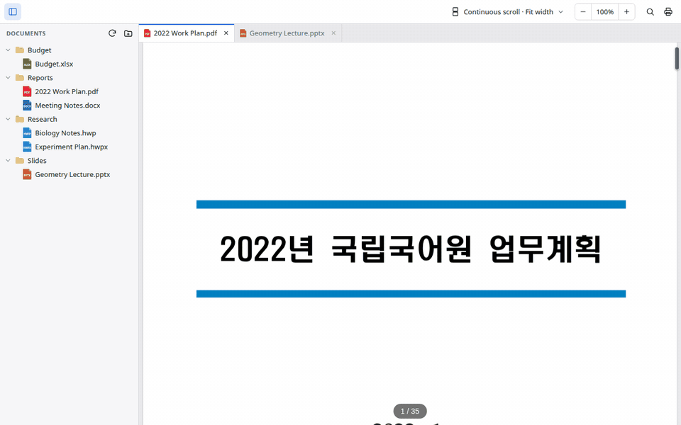
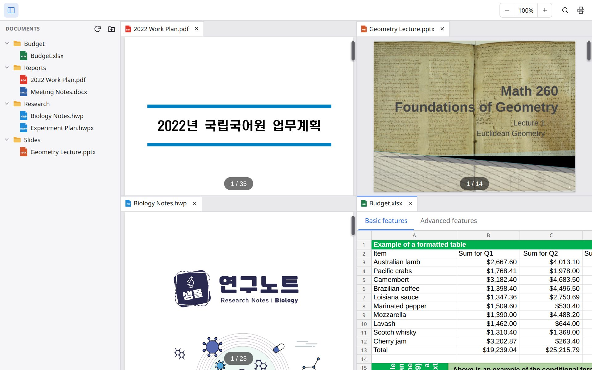
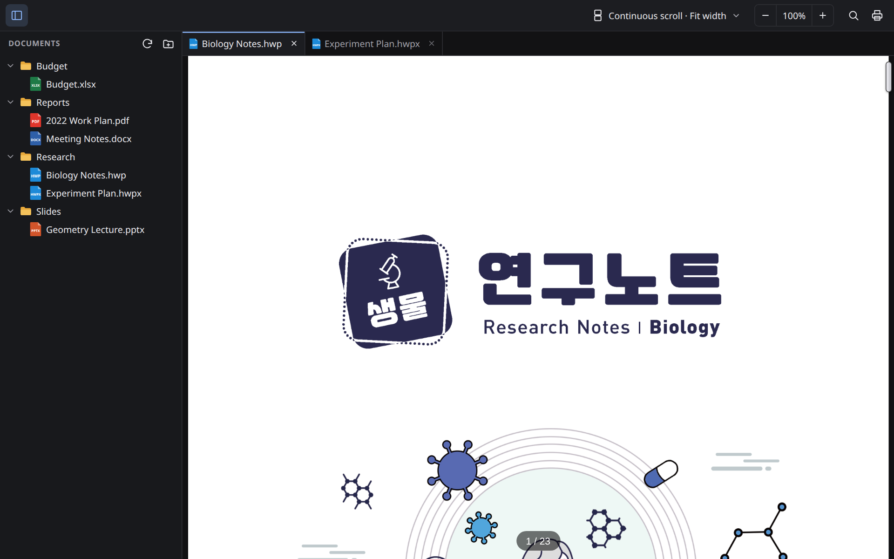
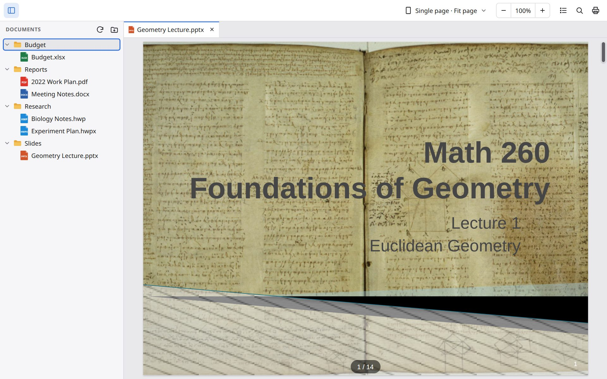

<div align="center">

# Doc Viewer

A desktop viewer for PDF, HWP, Word, Excel and PowerPoint files. Works offline on Windows, macOS and Linux.

[](https://github.com/jwgung/doc-viewer/releases/latest)
[](#download)
[](https://github.com/jwgung/doc-viewer/actions/workflows/ci.yml)

**English** · [한국어](README.ko.md)


</div>

Doc Viewer opens documents without Office or Hangul installed. Documents are rendered inside the app and are not uploaded anywhere. There is no account and no data collection.

Website: https://jwgung.github.io/doc-viewer/

## Features

- **Formats:** PDF, HWP/HWPX, DOC/DOCX, XLS/XLSX/CSV, PPT/PPTX, Markdown and plain text. Files with the wrong extension are detected by content.
- **Folders and tabs:** open a folder in the sidebar and keep several documents open in tabs. Rename or delete files from the sidebar.
- **Split view:** drag a tab or a file to the edge of a document to split the window, up to four panes.
- **Session restore:** open tabs, page, zoom and split layout come back when you restart. <kbd>Ctrl</kbd>+<kbd>Shift</kbd>+<kbd>T</kbd> reopens a closed tab. A tab can be duplicated to view two parts of one document.
- **Video in slides:** video and audio embedded in PPTX files play on the slide.
- **Light and dark theme**, following the system setting.

<div align="center">

<br><sub>Drag a tab or a file to an edge to split the window.</sub>
</div>

## Download

Get the latest version from **[Releases](https://github.com/jwgung/doc-viewer/releases/latest)**.

| OS | File | First launch |
|---|---|---|
| **Windows** 10 / 11 | `…-windows-setup.exe` (or `…-windows.msi`) | The app is not code-signed yet. If SmartScreen appears, click **More info → Run anyway**. |
| **macOS** (Apple silicon & Intel) | `…-macos.dmg` | Not notarized yet. Right-click the app → **Open**, or allow it in *System Settings → Privacy & Security*. |
| **Linux** (Ubuntu 22.04+ and similar) | `…-linux-amd64.deb` or `…-linux-amd64.AppImage` | For the AppImage, make it executable (`chmod +x`) and run it. |

> [!NOTE]
> On older Windows 10 without WebView2, the installer downloads it once. This is the only time an internet connection is needed.
> The macOS and Linux builds are new; please [open an issue](https://github.com/jwgung/doc-viewer/issues) if something looks wrong.

## Supported formats

| Kind | Extensions |
|---|---|
| PDF | `pdf` |
| Hangul (HWP) | `hwp`, `hwpx`, `hwt` |
| Word | `doc`, `docx`, `docm`, `dot`, `dotx`, `dotm` |
| Excel | `xls`, `xlsx`, `xlsm`, `xlt`, `xltx`, `xltm`, `csv`, `tsv` |
| PowerPoint | `ppt`, `pptx`, `pptm`, `pps`, `ppsx`, `pot`, `potx` |
| Text & data | `md`, `txt`, `log`, `json`, `xml`, `toml`, `yaml`, and other text files (config, source code, subtitles, diffs) |

Files with a wrong or missing extension are recognized by their content. Password-protected Office files ask for the password.

## More screenshots

<table>
<tr>
<td width="50%"><br><sub>PDF, slides, HWP and a spreadsheet side by side</sub></td>
<td width="50%"><br><sub>Dark theme with a Hangul (HWP) document</sub></td>
</tr>
<tr>
<td colspan="2"><br><sub>Slides, one page at a time (the mouse wheel flips pages)</sub></td>
</tr>
</table>

## Keyboard & mouse

| Action | Shortcut |
|---|---|
| Open folder | <kbd>Ctrl</kbd>+<kbd>O</kbd> |
| Close tab / reopen closed tab | <kbd>Ctrl</kbd>+<kbd>W</kbd> / <kbd>Ctrl</kbd>+<kbd>Shift</kbd>+<kbd>T</kbd> |
| Next / previous tab | <kbd>Ctrl</kbd>+<kbd>Tab</kbd> / <kbd>Ctrl</kbd>+<kbd>Shift</kbd>+<kbd>Tab</kbd> |
| Split right | <kbd>Ctrl</kbd>+<kbd>\\</kbd> (or drag a tab to an edge) |
| Duplicate tab | Right-click a tab → **Duplicate tab**, or drag with <kbd>Ctrl</kbd> (<kbd>Option</kbd> on macOS) |
| Zoom | <kbd>Ctrl</kbd>+wheel, <kbd>Ctrl</kbd>+<kbd>=</kbd> / <kbd>Ctrl</kbd>+<kbd>-</kbd>, reset with <kbd>Ctrl</kbd>+<kbd>0</kbd> |
| Find / print | <kbd>Ctrl</kbd>+<kbd>F</kbd> / <kbd>Ctrl</kbd>+<kbd>P</kbd> |
| Rename / move to trash (sidebar) | <kbd>F2</kbd> / <kbd>Del</kbd> |

On macOS, use <kbd>⌘</kbd> instead of <kbd>Ctrl</kbd> for most shortcuts. Switching tabs stays <kbd>Ctrl</kbd>+<kbd>Tab</kbd>, and wheel zoom stays <kbd>Ctrl</kbd>+wheel (trackpad pinch also works).

## FAQ

**Do my documents get uploaded anywhere?**
No. Doc Viewer has no server. Files are read from your disk and rendered inside the app.

**Can I edit documents?**
No. It is a viewer only.

**Some layouts look slightly different from Office/Hangul.**
Rendering uses open-source engines, so complex documents may look slightly different. Fonts embedded in documents are not used yet; your system fonts are used instead. Issues with sample files are welcome.

**Is there a mobile version?**
An Android version lives in a separate repository.

## Build from source

Requirements: Node.js 24, pnpm 10, Rust (stable). On Linux also `libwebkit2gtk-4.1-dev librsvg2-dev patchelf`.

```bash
pnpm --dir web install
pnpm --dir desktop install
cd desktop
pnpm tauri dev      # run in development
pnpm tauri build    # build installers for your OS
```

Project layout:

- `web/`: the document renderer (pdf.js, rhwp, a patched copy of web-ppt, and more), shared with the Android app.
- `desktop/`: the [Tauri](https://tauri.app) shell: tabs, folder explorer and split view in `desktop/src/`; file access, format detection and the local `doc` scheme in `desktop/src-tauri/`.
- Releases: pushing a `v*` tag builds Windows, macOS and Linux installers and attaches them to a GitHub Release.

## Acknowledgements

Built with open-source projects including [pdf.js](https://github.com/mozilla/pdf.js), [rhwp](https://github.com/edwardkim/rhwp), [web-ppt](https://github.com/unStone/web-ppt) and [Tauri](https://tauri.app). Third-party licenses are bundled with the app; see [NOTICE.md](NOTICE.md).

This product was developed with reference to the HWP document format specification published by Hancom Inc.
